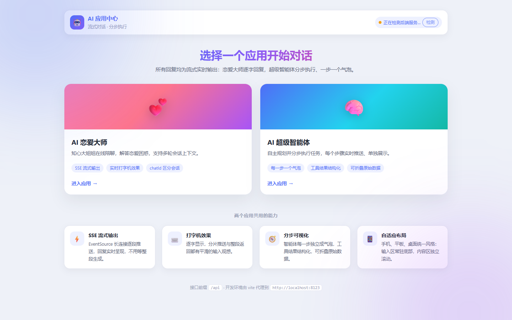
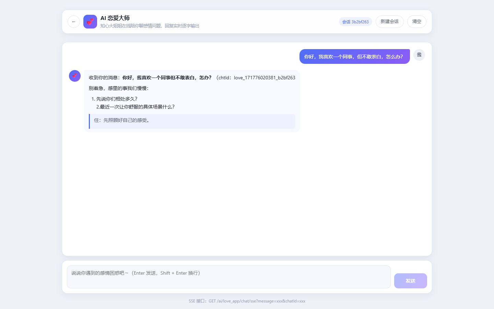
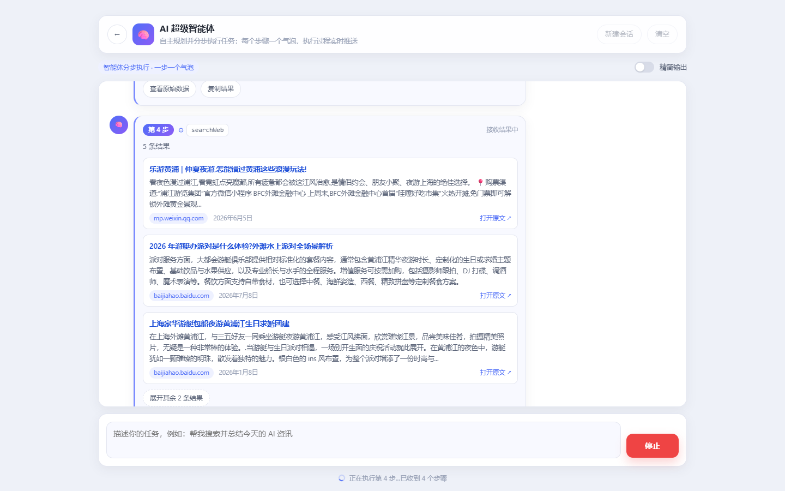
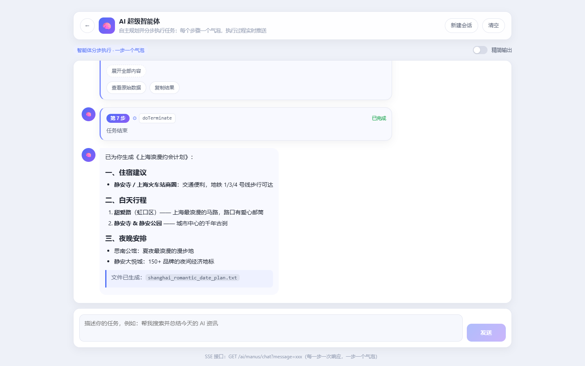
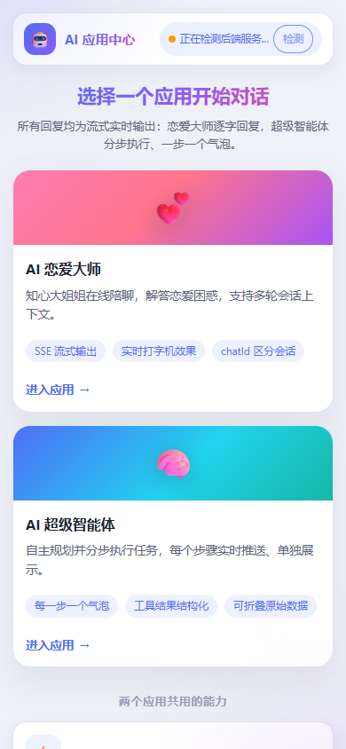
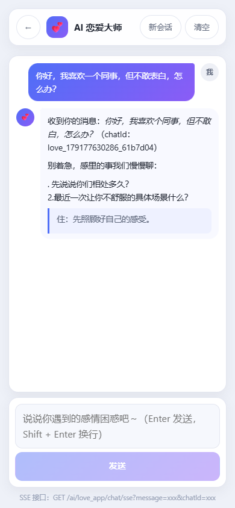
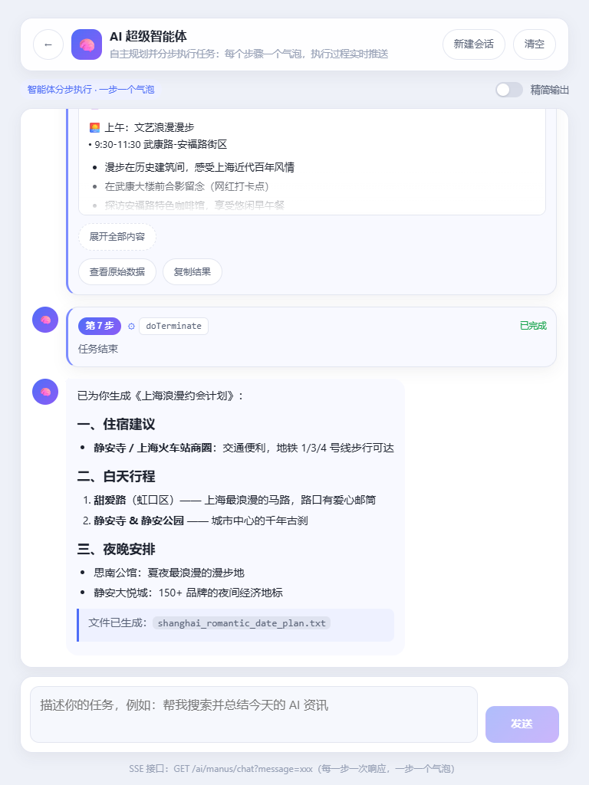

# cai-ai-agent-frontend

AI 应用中心前端：一个主页用于切换两个应用，两个应用都是 **聊天室风格 + SSE 实时流式输出（打字机效果）**。

- 技术栈：**Vue 3 + Vite + Vue Router**、**浏览器原生 EventSource**（SSE）、**Axios**（普通 HTTP）、marked（Markdown 渲染）
- 后端接口前缀：`http://localhost:8123/api`

## 页面与接口

| 页面 | 路由 | 接口 | 说明 |
| --- | --- | --- | --- |
| 主页（切换应用） | `/#/` | — | 卡片式入口 + 后端连通状态检测 |
| 页面 1：AI 恋爱大师 | `/#/love` | `GET /ai/love_app/chat/sse?message=xxx&chatId=xxx` | 进入页面自动生成聊天室 `chatId`，可在头部「新建会话」换新 id |
| 页面 2：AI 超级智能体 | `/#/manus` | `GET /ai/manus/chat?message=xxx` | 无 `chatId`，**每个 SSE 响应（＝一个步骤）单独一个气泡** |

## 界面预览

桌面（1440×900）：

| 主页 | AI 恋爱大师 | AI 超级智能体（执行中） | 执行完成 |
| --- | --- | --- | --- |
|  |  |  |  |

手机 / 平板（同一套代码，响应式适配）：

| 手机主页（390×844） | 手机聊天（输入区常驻底部） | 平板智能体（768×1024） |
| --- | --- | --- |
|  |  |  |

（截图为 `mock/server.mjs` 回放真实抓包数据的联调效果）

## 快速开始

```bash
# 1. 安装依赖（Windows 上如果 npm 脚本被策略拦截，可用 npx pnpm 或 corepack）
pnpm install     # 或 npm install

# 2. 启动开发服务器（默认 http://127.0.0.1:5173）
pnpm dev

# 3. 打包
pnpm build
pnpm preview
```

> Node 版本要求：Node 18+（推荐 20/22）。

## 后端连通性 / 跨域

开发环境已经配置好 **vite 代理**，前端请求 `/api/...` 会被转发到 `http://localhost:8123/api/...`，
所以 **不需要后端额外配置 CORS**，SSE 长连接也不会被跨域策略打断。

```js
// vite.config.js
server: {
  proxy: {
    '/api': { target: 'http://localhost:8123', changeOrigin: true },
  },
}
```

如果需要直连后端（例如部署后由 Nginx 同域转发），把 `.env` 改成：

```bash
VITE_API_BASE_URL=http://localhost:8123/api
```

## 目录结构

```
src/
├─ main.js                       # 入口
├─ App.vue                       # 根组件（路由出口 + 页面过渡）
├─ router/index.js               # 路由：/ 主页、/love 恋爱大师、/manus 超级智能体
├─ api/
│  ├─ config.js                  # 接口前缀 API_BASE_URL + 接口路径常量
│  └─ http.js                    # Axios 实例（普通请求用；SSE 不用 axios）
├─ utils/
│  ├─ sse.js                     # EventSource 封装：GET + encodeURIComponent + 关闭/错误处理
│  ├─ agentStepSplitter.js       # 把流式文本按 "Step N:" 切成一个个步骤（一步一个气泡）
│  ├─ agentStep.js               # 步骤文本解析：工具名 / 搜索结果 / 文件路径 / 纯文本
│  ├─ chatId.js                  # 聊天室 id 生成 / 复用 / 重置
│  └─ markdown.js                # Markdown 渲染（流式安全：代码块未闭合时不闪）
├─ hooks/
│  └─ useTypewriter.js           # 打字机：每个气泡一个实例，逐字吐出
├─ components/
│  ├─ AppHeader.vue              # 全站统一头部（主页 / 两个聊天页共用）
│  ├─ ChatRoom.vue               # 通用聊天室：消息列表 + 输入框 + 流式控制 + 精简开关
│  └─ AgentStepBubble.vue        # 步骤气泡：工具徽标 + 结构化结果 + 折叠/复制
└─ views/
   ├─ HomeView.vue               # 主页：切换应用 + 能力说明
   ├─ LoveAppView.vue            # 页面 1
   └─ ManusAppView.vue           # 页面 2（step-mode）
mock/
├─ server.mjs                    # 本地假后端：回放真实抓包数据（可选）
├─ realEvents.json               # 从真实 /api/ai/manus/chat 抓取的步骤数据
└─ static-server.mjs             # 托管 dist/ 并代理 /api，用于验证打包产物
scripts/
├─ step-sim.mjs                  # 步骤切分/解析的纯逻辑自测
├─ verify-real.mjs               # 用真实抓包数据验证解析结果
└─ e2e-check.mjs                 # 端到端 UI 自测（可选依赖 playwright）
```

## 关键实现说明

### 1. SSE 必须用 EventSource，不能用 Axios

`src/utils/sse.js` 核心逻辑：

```js
const query = Object.entries(params)
  .map(([k, v]) => `${encodeURIComponent(k)}=${encodeURIComponent(v)}`) // 中文必须编码
  .join('&')

const source = new EventSource(`${API_BASE_URL}${path}?${query}`)
source.onmessage = (e) => onMessage(e.data)   // 收到一段就渲染一段
source.onerror = ...                          // 关闭连接，避免自动重连
source.close()                                // 离开页面/停止生成时务必关闭
```

- 查询参数统一 `encodeURIComponent`，中文、emoji、`&`、空格都不会出错；
- 服务端返回 `[DONE]` 时自动截断并结束流（Spring AI Flux 的常见约定）；
- 后端推完直接断开连接时按「正常结束」处理，不弹错误。

### 2. 智能体：一个步骤 = 一个气泡

后端 `/ai/manus/chat` 每次 SSE 响应就是智能体的一个步骤，形如：

```
\uFEFFStep 2: 工具 searchWeb 完成了它的任务！结果: "{\"position\":1,\"title\":\"...\"}"
Step 3: 工具 generatePDF 完成了它的任务！结果: "PDF generated successfully to: D:\\...\\x.pdf"
Step 9: 已为你生成《上海浪漫约会计划》…（最终答复，Markdown）
```

`src/utils/agentStepSplitter.js` 负责把它切成独立步骤：

- **只认“以步骤标记开头”的文本**（`Step N:`、`第 N 步：`、`[Step N]`），正文里夹带的 `Step 1` 字样不会被误切；
- 兼容真实的三个细节：
  1. 事件开头的 **BOM（`\uFEFF`）**；
  2. 上一步结果与下一个步骤头**紧贴在一起**（`..."Step 3: ...`，没有换行）；
  3. 步骤头可能**先到一半**（先收到 `Step 9`，冒号和正文下一个事件才到）——这时会先开一个气泡占位，编号到齐后自动补上；
- 流结束时调用 `cut()`，把缓冲里最后一段单独成泡（后端最后一步常常不带换行）。

`ChatRoom.vue` 的 `step-mode` 逻辑：出现新步骤就新建气泡，上一步的内容就地落定（不再等打字机），
底部还会显示「正在执行第 N 步…已收到 M 个步骤」。

### 3. 工具结果做成“可读的文档”

`src/utils/agentStep.js` 把原始文本解析成结构化数据，避免把一坨 JSON 直接糊在页面上：

| 结果类型 | 识别方式 | 展示效果 |
| --- | --- | --- |
| 搜索结果 | `[{...},{...}]`，或**没有外层方括号的裸对象串**（百度搜索就是这种） | 编号条目：标题（可点击）+ 摘要 + 域名 + 日期，默认展示 3 条，其余「展开其余 N 条结果」 |
| 文件结果 | 结果里含 `D:\...\xxx.pdf` 之类路径 | 📄 等宽字体路径展示 |
| 长文本 | 例如 `readFile` 读出的文件内容（含 `\n` 转义） | 还原换行后按 Markdown 渲染，超过一屏先折叠，可「展开全部内容」 |
| 纯短文本 | 例如 `doTerminate` → `"任务结束"`、报错信息 | 只显示一行摘要，不再重复一块内容 |

每个步骤气泡还提供「查看原始数据」（展开原始 JSON）与「复制结果」；头部开关 **精简输出**
可以只保留「第 N 步 + 工具名 + 一行摘要」，长任务一眼看清执行脉络。

### 4. 打字机效果

`src/hooks/useTypewriter.js`：**每个气泡一个打字机实例**（`ChatRoom` 里按消息 id 建池），
SSE 每收到一段先入队，再按 16ms 的节奏逐字吐出；积压越多吐字越快（1～6 字/次），
这样无论后端是一次性返回整段、还是按 token 分片推送，页面上都是平滑的打字过程。
步骤结束时直接把整段内容落定（`finalizeMessage`），不会出现「最后几个字卡住」。

### 5. 聊天室 id

`src/utils/chatId.js`：进入页面时生成 `love_<时间戳>_<随机串>`，存入 `sessionStorage`
（同一次会话刷新不丢上下文，关闭标签页后重新生成）；点击「新建会话」会生成新的 id。

### 6. 交互细节

- 用户消息靠右（渐变气泡），AI 消息靠左；步骤气泡带「第 N 步」徽标与工具名 chip；
- 输入框 `Enter` 发送、`Shift + Enter` 换行（兼容中文输入法 `isComposing`）；
- 流式输出期间可点「停止」中断，输入框自动禁用；
- 新内容到达时自动贴底滚动，用户手动上滑浏览时不打扰。

## 界面风格统一 & 响应式适配

### 1. 设计令牌（`src/assets/main.css`）

所有颜色、圆角、阴影、间距、动效都收敛成 CSS 变量，页面样式只引用变量，不再各写各的色值：

```css
:root {
  --brand / --brand-2 / --brand-soft / --link / --success / --danger
  --r-xs … --r-xl / --r-full        /* 圆角阶梯 */
  --shadow-sm / --shadow / --shadow-lg
  --gap-xs / --gap-sm / --gap / --gap-lg
  --font-sans / --font-mono
  --t-fast / --t-base               /* 过渡时长 */
  --wide: 1080px                    /* 页面内容最大宽度 */
}
```

### 2. 共用组件类

| 类名 | 用途 |
| --- | --- |
| `.page` / `.page-inner` | 页面容器：统一内外边距、最大宽度、左右安全区 |
| `.surface` / `.surface-lg` | 卡片 / 面板：统一背景、描边、圆角、阴影 |
| `.btn` / `.btn-primary` / `.btn-danger` / `.btn-lg` / `.btn-icon` | 全站按钮体系（含 hover / active / disabled / focus-visible） |
| `.chip` / `.tag` / `.icon-chip` | 徽标、标签、应用图标块 |
| `.switch` | 开关（精简输出等） |
| `.toolbar` / `.toolbar-end` | 头部操作区排版 |
| `.markdown-body` | AI 回复与文件内容的 Markdown 样式 |

`src/components/AppHeader.vue` 把头部也统一了：主页用品牌模式（渐变标题 + 后端状态），
聊天页用 `back` + `sticky` 模式（返回按钮 + 图标 + 标题 + 右侧「新建会话 / 清空」槽位）。

### 3. 断点与布局策略

| 断点 | 主页 | 聊天页 |
| --- | --- | --- |
| ≤ 420px | 卡片单列；后端状态条整行；能力卡图标改上下结构 | 输入区上下排列，发送按钮整行 44px 高 |
| ≤ 520px | — | 同上，输入框高度限制为 `min(26vh, 112px)` |
| ≤ 640px | 卡片单列 | 按钮文案缩写为「新会话」、隐藏会话号与开关文字，气泡接近满宽（AI 占满整列、用户 82%） |
| 641–900px（平板） | 卡片两列（`auto-fit` 自动换行） | AI 步骤卡片占满整列，长文本 / 搜索结果更省空间 |
| ≥ 901px（桌面） | 卡片两列，内容宽 1080px | 消息列收窄到 `min(80%, 720px)`，避免行长过长 |
| 高度 ≤ 520px（横屏手机） | — | 压缩头部/输入区留白、隐藏底部提示，把高度留给消息区 |

### 4. 移动端关键处理

- **视口高度**：聊天页用 `height: 100dvh`（带回退 `100vh`），配 `env(safe-area-inset-*)`
  保证 iPhone 刘海屏与底部指示条不遮挡内容，输入区常驻底部、消息区独立滚动；
- **不横向溢出**：flex 子项统一 `min-width: 0` + `max-width: min(...)`，长 URL / JSON 一律
  `overflow-wrap: anywhere`，表格与代码块改为内部横向滚动；
- **字号自适应**：标题与间距用 `clamp()` 连续缩放，减少断点跳变；
- **触摸友好**：`@media (pointer: coarse)` 下按钮 ≥ 40px、搜索结果标题与「打开原文」≥ 32px、
  隐藏滚动条；输入框字号提升到 16px，避免 iOS Safari 聚焦时自动放大页面；
- **无障碍与偏好**：统一 `:focus-visible` 焦点样式（键盘可见、鼠标不打扰），
  支持 `prefers-reduced-motion` 关闭动效。

### 5. 自动化测试用的稳定钩子

样式重构不保证类名稳定，所以给关键节点加了语义化属性：

| 属性 | 位置 | 用途 |
| --- | --- | --- |
| `data-action="chat-send"` | 发送按钮 | 发送消息（列表页做 E2E 时用它定位） |
| `data-action="chat-stop"` | 停止按钮 | 中断流式输出 |
| `data-ready="true"` | `.chat-page` | 组件挂载完成（路由过渡结束），等到它再操作输入框 |
| `data-role="chat-input"` | 输入框 | 需要区分多个输入框时使用 |

> 提示：路由切换带过渡动画，直接 `fill` 输入框可能被组件首次渲染覆盖，
> 自动化脚本应先等待 `.chat-page[data-ready="true"]`。

### 6. 响应式自测

在 5 种视口（320×568 / 390×844 / 844×390 横屏 / 768×1024 / 1440×900）下，对
主页 + 恋爱大师 + 智能体（执行中 / 完成）逐页截图并做布局体检，检查三件事：

1. 页面是否出现横向溢出（`scrollWidth > clientWidth`）；
2. 输入区是否始终落在视口内、消息区是否还有可用高度；
3. 触屏设备上是否存在过小的点击目标（< 32px）。

```bash
pnpm build
PORT=4173 BACKEND=http://localhost:8124 node mock/static-server.mjs   # 另开终端跑 mock
# 结论：全部视口横向溢出 0px；输入区始终在视口内（含横屏手机）；触屏无过小点击目标
```

> 桌面端搜索结果的「打开原文」等链接高度约 18–20px，这是鼠标场景下的正常密度：
> 相关尺寸只在 `@media (pointer: coarse)`（触屏）里放大到 32px 以上。

## 本地自测

没有后端也能看效果（假后端会**回放真实抓包的步骤数据**）：

```bash
node mock/server.mjs      # 默认 8123（被占用时用 PORT=8124）
pnpm dev                  # 另开一个终端
```

打开 http://127.0.0.1:5173 即可看到「一步一个气泡」的分步效果。
若 8123 已被真实后端占用，可让前端指向假后端：

```bash
PORT=8124 node mock/server.mjs
VITE_BACKEND_TARGET=http://localhost:8124 pnpm dev
```

纯逻辑自测（不需要浏览器）：

```bash
node scripts/step-sim.mjs      # 步骤切分 / 解析的各种边界场景
node scripts/verify-real.mjs   # 用 mock/realEvents.json 里的真实数据验证
```

验证打包产物（静态托管 `dist/` 并把 `/api` 代理到后端）：

```bash
pnpm build
PORT=4173 BACKEND=http://localhost:8123 node mock/static-server.mjs
```

端到端 UI 自测（需要 Playwright，属于可选依赖，按需自行安装）：

```bash
pnpm add -D playwright && npx playwright install chromium   # 或用系统已装的 Chrome
BASE_URL=http://127.0.0.1:4173 node scripts/e2e-check.mjs
```
